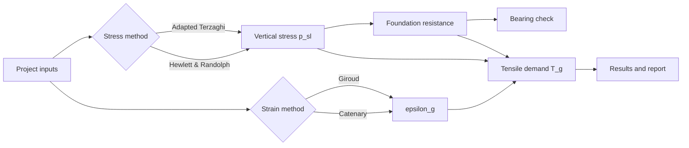

# Pile-Supported Embankment Designer

<div align="center">

**Professional preliminary-design desktop calculator for geosynthetic-reinforced, pile-supported embankments.**

[](https://www.python.org/)
[](https://docs.python.org/3/library/tkinter.html)
[](https://pyinstaller.org/)
[](#project-status)

<a href="#overview">Overview</a> &nbsp;•&nbsp;
<a href="#features">Features</a> &nbsp;•&nbsp;
<a href="#quick-start">Quick Start</a> &nbsp;•&nbsp;
<a href="#engineering-methods">Methods</a> &nbsp;•&nbsp;
<a href="#workflow">Workflow</a>

</div>

## Overview

Pile-Supported Embankment Designer is a Windows desktop application for preliminary geotechnical design checks of geosynthetic-reinforced column-supported embankments. It provides a guided input form, transparent calculation trace, design checks, and plain-text report export.

> **Engineering notice**
> This software supports preliminary design and engineering review. Confirm the governing code, project criteria, soil model, load cases, and construction requirements before issuing design information for construction.

## Features

- **Two stress methods:** Adapted Terzaghi and Hewlett & Randolph.
- **Two strain methods:** Giroud simplified and Catenary.
- **Transparent calculations:** Every equation, substitution, result, and engineering reference is shown in the application.
- **Design checks:** Soil arching mobilization and foundation bearing capacity.
- **Worked example:** One-click loading of the included design example values.
- **Report export:** Save a calculation sheet as a `.txt` file.
- **Single-file runtime:** `standalone_app.py` contains the complete application and can be packaged as one Windows executable.

## Quick Start

### Run from Python

Requirements: Windows, Python 3.9 or newer with Tkinter.

```powershell
cd pse_app
py -3 standalone_app.py
```

You can also double-click [`run_project.bat`](run_project.bat).

### Build the Windows executable

```powershell
cd pse_app
py -3 -m pip install -r requirements.txt
py -3 -m PyInstaller --onefile --windowed --name Pile_Supported_Embankment_Designer standalone_app.py
```

The executable is created at:

```text
dist\Pile_Supported_Embankment_Designer.exe
```

Build output is excluded from Git by [`.gitignore`](.gitignore).

## How To Use

1. Open the application and enter the project or design name.
2. Select a stress method and a strain method.
3. Enter the embankment, platform, column, soil, loading, and settlement inputs.
4. Select **Load Example** to inspect the included reference case, or select **Calculate** for project inputs.
5. Review **Results** and **Calculation Details**.
6. Select **Save Report** to export the calculation sheet.

<details>
<summary><strong>Hewlett &amp; Randolph input requirement</strong></summary>

The Hewlett &amp; Randolph method requires `Kp`, the passive earth-pressure coefficient of the embankment fill. It must be entered when that method is selected; the application does not silently assume a project-specific value.

</details>

## Engineering Methods

| Design stage | Available method | Output |
| --- | --- | --- |
| Vertical stress above geosynthetic | Adapted Terzaghi | `p_sl` |
| Vertical stress above geosynthetic | Hewlett & Randolph | `p_sl` |
| Geosynthetic strain | Giroud simplified | `epsilon_g` |
| Geosynthetic strain | Catenary | `epsilon_g` |
| Foundation response | Bearing resistance check | `q_ult`, `q_a`, status |
| Reinforcement demand | Tensile demand equation | `T_g` |

## Workflow



## Project Structure

| File | Purpose |
| --- | --- |
| [`standalone_app.py`](standalone_app.py) | Complete single-file desktop application |
| [`run_project.bat`](run_project.bat) | Windows direct-launch endpoint |
| [`calculation_engine.py`](calculation_engine.py) | Original calculation orchestration |
| [`methods/`](methods/) | Stress-method implementations |
| [`strain_methods/`](strain_methods/) | Strain-method implementations |
| [`worked_example_test.py`](worked_example_test.py) | Worked-example validation |
| [`requirements.txt`](requirements.txt) | PyInstaller build dependency |

## Validation

Run the engineering validation with:

```powershell
py -3 worked_example_test.py
```

The validation preserves the documented calculation behavior and explicitly reports any difference between calculated values and reference example values rather than silently changing the equations.

## Project Status

This is an engineering calculation tool for preliminary design and review. It is not a substitute for project-specific geotechnical investigation, structural design, construction-stage verification, or approval by the responsible engineer.

## Contributing

Keep calculation changes traceable, preserve units and validation checks, and add or update a focused validation case for any changed engineering equation.

## License

No open-source license has been declared for this project. Add a license file before redistributing the code under an open-source license.
